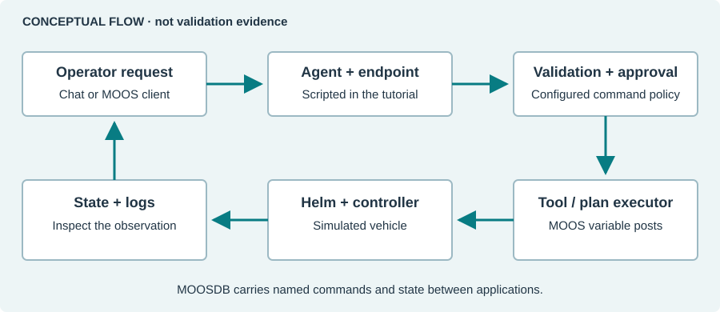

# How commands reach a vehicle

The system separates the operator's request from plan execution. This lets an operator inspect a proposed action before the executor sends mission commands.

{ .diagram }

The diagram is conceptual. Its [editable SVG source](../assets/command-flow.svg) is part of the handbook. It is not a screenshot or evidence from a run.

## The command path

1. The operator submits a request through a viewer, console, or other MOOS client.
2. `pLLMAgent` obtains a response from the configured endpoint. The first tutorial uses a scripted endpoint.
3. Capability rules validate a proposed tool call. The configured approval policy determines whether the agent must wait.
4. After approval, a tool posts MOOS variables or submits a behavior tree.
5. The executor and mission behaviors act on those variables. The helm and controller produce vehicle commands.
6. The simulator publishes navigation state. Queries and logs provide evidence of the resulting behavior.

This list is the text equivalent of the diagram.

## Why capabilities and plans are separate

A capability defines an action's interface. A behavior tree arranges actions and conditions into a plan. A plan can continue without a model request for every step.

Shared capability definitions help the agent and executor use consistent command semantics. They do not remove the need for the mission's required behaviors, valid inputs, or runtime checks.

## Approval has a defined boundary

The example movement proposal waits for `y`. Some configured tools can use `confirm=false`. Buttons and other MOOS clients also have their own paths. Do not infer that every command in every mission requires approval.

The [component interfaces](../reference/interfaces.md) define those policies. The [result guide](results.md) explains what the recorded checks establish.
